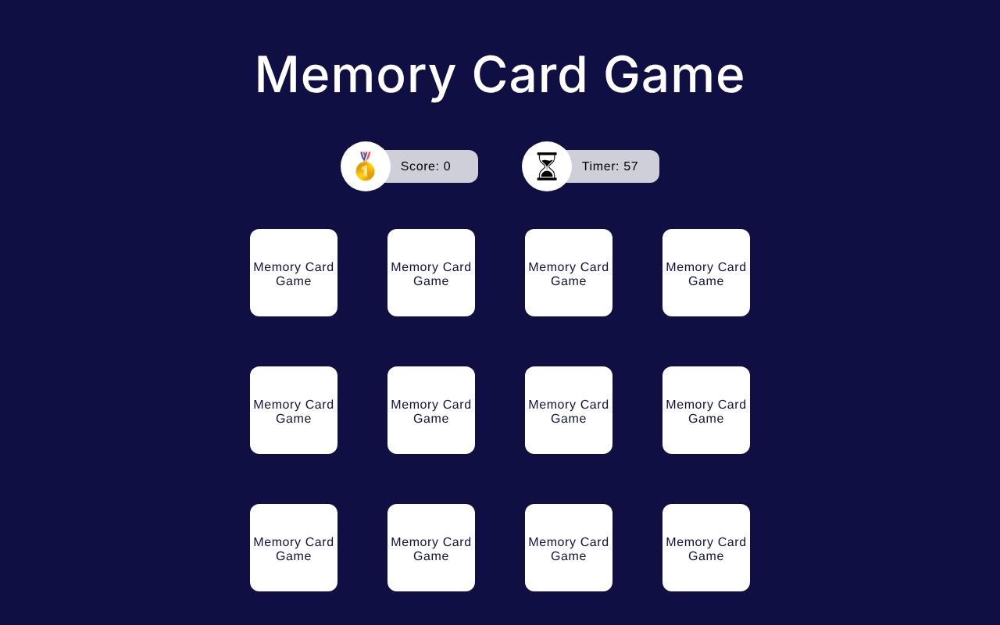

# 🎮 Professions Game

**Play it: [professions-game.web.app](https://professions-game.web.app)**

Three quick browser games, each played to a different style of music. When you finish, your scores
are sent to a Cloud Function that asks an LLM which kind of profession fits how you played, and
returns a short write-up with example careers.


<p align="center"></p>

## How a session works

1. **Start.** Enter your name and turn the volume up.
2. **Memory cards** (classical music). Flip and match pairs before the timer runs out.
3. **Reaction time** (EDM). Click the circle the moment it turns the target color.
4. **Spot the difference** (jazz). Find the 7 differences between two images.
5. **Results.** Score, time used and the music genre for each game go to the `processGameResult`
   Cloud Function, which returns an AI-written profession match.

Between games, a transition screen shows your score and time, and a countdown beeps you into the next one.

## How it's built

- **Angular 18 standalone components**, one per screen (`start-session`, `countdown`, each game,
  `game-transition`, `loading-results`, `final-results`).
- **`GameSessionService`** is a small state machine over the session steps. It exposes the current
  step, timer and score as RxJS observables, so the header (`game-state-info`) just subscribes and
  switches to whichever game is active.
- **One service per game** implements a shared `GameService` interface (`startGame`, `gameFinished`,
  `score$`, `remainingTime$`, `running$`, `song`), so adding a fourth game means writing one service and
  one component and adding it to the session list.
- **Audio and images are preloaded** at startup so music and sprites start instantly.
- **Firebase Hosting** serves the build; the scoring call goes to a Cloud Functions endpoint.

## Run it locally

```bash
git clone https://github.com/Ficabral10/Professions.git
cd Professions
npm install
npm start          # http://localhost:4200
```

Other commands:

```bash
npm run build      # production build -> dist/
npm test           # Karma + Jasmine unit tests
firebase deploy --only hosting
```

## Project structure

```
src/app/
  services/        session state machine, one service per game, results API client
  views/           start, countdown, transition, loading and results screens
  views/games/     memory-card-game, reaction-time, spot-the-difference
  common/          score and timer header
public/assets/     music, sound effects and game images
```

## Music credits

Classical: J.S. Bach, Prelude in G Minor · Jazz: TrackTribe, "Smoke Jacket Blues" · EDM: Diamond Ace, "Too Soon"

## License

Code under the [MIT License](LICENSE).
